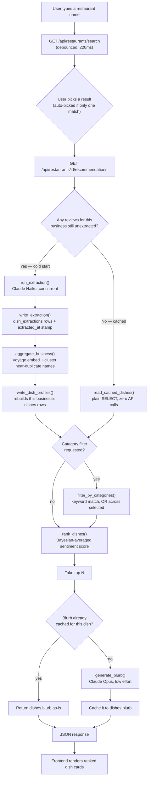

# Implementation walkthrough: from a user's keystroke to a ranked dish

This traces exactly what happens between a user typing a restaurant name and
seeing ranked dish recommendations — file by file, function by function —
for both paths the system can take: a restaurant nobody has looked up
before, and one that's already cached. For *why* these specific choices
were made, see [`DESIGNDECISIONS.md`](DESIGNDECISIONS.md); this doc is the
*how*.

## Architecture at a glance

One process, one port: `api/main.py` (FastAPI) serves both the JSON API and
the static frontend (`frontend/index.html`), so there's no CORS
configuration to manage. It talks to three external systems:

- **Postgres + pgvector** — businesses, reviews, extracted dish mentions,
  aggregated dish profiles, and their vector embeddings
- **Claude (Anthropic)** — structured extraction from review text (Haiku)
  and recommendation blurb generation (Opus)
- **Voyage** — embeddings used to cluster near-duplicate dish names

`api/main.py` itself contains no business logic — every endpoint is a thin
wrapper around functions in `pipeline/`, the same functions the CLI scripts
(`lookup_restaurant.py`, `recommend.py`) call directly. That's deliberate:
the API didn't introduce a second implementation of anything, it just put
HTTP in front of what the CLI had already proven.

## The one branch that matters: cold start vs. cached

Everything downstream of "has this restaurant been looked up before"
behaves differently, so it's worth being explicit about the fork before
walking through the rest:



A brand-new restaurant walks the left branch and pays for Claude and Voyage
calls; every lookup after that walks the right branch and touches only
Postgres, until the only remaining cost is whichever dishes don't have a
blurb cached yet.

## Step by step

### 1. Typing a name — predictive search

`frontend/index.html`'s search input fires on every keystroke, debounced
220ms (`fetchSuggestions()`), hitting:

```
GET /api/restaurants/search?name=<query>
```

`search_restaurants()` in `api/main.py` calls `find_businesses()`
(`pipeline/lookup_restaurant.py`), an `ILIKE '%name%'` substring match
against `businesses`, case-insensitive. Results come back as JSON with
name *and address* — not just name — because restaurant names collide in
real data ("Royal Indian Cuisine" matches two different, several-blocks-
apart restaurants in this dataset), and the UI needs enough to tell them
apart. The frontend renders up to 8 results as a live dropdown with the
matched substring highlighted; more than 8 shows a "...and N more, keep
typing" hint instead of dumping the whole list.

### 2. Picking a restaurant

Exactly one match → skip straight to step 3. More than one → the user
picks from the dropdown (or, in the CLI, a numbered prompt). Either way,
once a `business_id` is chosen, the frontend calls:

```
GET /api/restaurants/{business_id}/recommendations?top_n=10
```

### 3. Ensuring the data exists: `get_dish_profiles()`

This is the function both `/recommendations` and `/categories` call
before doing anything else (`pipeline/lookup_restaurant.py`). It's the
entire on-demand architecture in one place:

```python
reviews = fetch_pending_reviews(cur, business_id, limit=None)
if reviews:
    # cold start — see 3a/3b
else:
    # cached — see 3c
```

**3a. Extraction** (only if `reviews` is non-empty). `run_extraction()`
(`pipeline/batch_extract.py`) fans the pending reviews out across a thread
pool (`DEFAULT_CONCURRENCY = 10`, configurable), and each worker calls
`extract_dishes()` (`pipeline/extract.py`) — one Claude Haiku call per
review, using structured outputs (`client.messages.parse` against a
Pydantic schema) so the response is guaranteed to parse, not just usually
well-formed JSON. The prompt asks for every distinct dish named in the
review, its sentiment, and up to three descriptive tags. Results are
written back on the main thread only (`write_extraction()` — psycopg
cursors aren't thread-safe to share), one `dish_extractions` row per dish
mention, and the review gets `extracted_at` stamped regardless of whether
it mentioned any dishes — so a review that genuinely has nothing to
extract doesn't get retried forever.

**3b. Aggregation.** `aggregate_business()` (`pipeline/aggregate.py`) rolls
every `dish_extractions` row for this business into one row per *distinct
dish* in `dishes`:
1. `group_by_normalized_name()` collapses exact-match duplicates
   (case/whitespace-insensitive) for free, before any API call happens.
2. The remaining distinct name strings get embedded via Voyage
   (`embed_all()`, chunked at 1,000 texts per request — Voyage's hard
   per-request cap, which a single very-reviewed restaurant can exceed on
   its own).
3. `cluster_by_embedding()` groups near-duplicate names by cosine
   similarity (threshold `0.87`) — a single vectorized NumPy matrix
   operation, not a Python loop, since that loop doesn't finish in
   reasonable time once a restaurant has thousands of distinct name
   strings.
4. Each cluster becomes one dish profile: canonical name = most common
   surface form, tags = top 5 most frequent across the cluster, mention/
   positive/negative counts summed, embedding = mean-pooled across the
   cluster's members.
5. `write_dish_profiles()` deletes this business's existing `dishes` rows
   and inserts the freshly computed set — a full recompute, not an
   incremental merge, because embedding-based clustering can draw
   slightly different boundaries as new extractions arrive, and
   reconciling that against previously-written rows risks duplicate or
   stale profiles.

**3c. Cached path.** If there were no pending reviews, none of the above
runs — `read_cached_dishes()` is a plain `SELECT` against `dishes`. No
Claude call, no Voyage call. This is the path that makes repeat lookups
effectively free.

### 4. Category filter (optional)

If the request includes `?categories=spicy,hearty`, `filter_by_categories()`
(`pipeline/categories.py`) narrows the dish list *before* ranking — a
request for "spicy" dishes should find the best spicy dish on the whole
menu, not whichever spicy dish happened to already be in the unfiltered
top 10. Matching is deterministic: each dish's stored tags are checked
against a small hand-curated keyword list per category, case-insensitive
substring match, OR semantics across multiple selected categories.

### 5. Ranking: `rank_dishes()`

(`pipeline/recommend.py`) Eligible dishes (at least `min_mentions` total
mentions, at least one non-neutral one) are scored with a Bayesian-averaged
blend: each dish's own positive ratio, pulled toward the restaurant's own
vote-weighted average ratio by an amount controlled by how much evidence
backs it (`CONFIDENCE_WEIGHT`). A dish with 3 mentions leans heavily on the
restaurant's baseline; one with 40 is judged almost entirely on its own
record. Sorted descending, tied by mention count, then sliced to `top_n`.

### 6. Blurb generation or cache read

For each of the top N, `get_or_generate_blurb()` checks `dishes.blurb`
first. If it's already populated (a previous request already generated
it), that exact text is returned — no API call. If not, `generate_blurb()`
calls Claude Opus with a prompt that explicitly grounds the output in that
dish's real tags and sentiment counts, permitting the model's general
knowledge of the dish only to support or explain that signal, never
override it — then the result is written to `dishes.blurb` before being
returned, so the next request for this dish is free.

### 7. Response → render

The endpoint returns a JSON array of `{rank, name, mention_count,
positive_count, negative_count, tags, blurb}`. The frontend turns each
into a dish card: a gradient rank badge, a green-to-red sentiment bar
sized to the positive ratio, the blurb as body text, tags as pills —
rendered with a small staggered fade-in as the cards appear.

## A real example, traced end to end

"The Royal Indian Cuisine" (Philadelphia), looked up for the first time:

1. Search for "Royal Indian Cuisine" → two matches (it collides with
   "Bombay Royal Indian Cuisine") → user picks the one at 272 S 20th St
2. `get_dish_profiles()` finds 28 pending reviews → cold start
3. `run_extraction()` fires 28 concurrent Haiku calls → 61 dish mentions
   written to `dish_extractions`
4. `aggregate_business()` collapses those 61 mentions into 34 distinct
   dish profiles (e.g. "Garlic naan," "naan," and "chicken" each absorbing
   several differently-worded mentions of the same dish)
5. No category filter in this request
6. `rank_dishes()`: "Garlic naan" (5/5 positive, 6 mentions) and "naan"
   (4/4, 4 mentions) rank just above "chicken" (12/14, 14 mentions) — a
   plain ratio sort would have buried "chicken" under dozens of
   single-mention dishes instead
7. Three blurbs generated fresh (none cached yet), each grounded in that
   dish's real tags — "chicken"'s blurb cites "flavorful," "well-prepared,"
   and "familiar favorite," the actual tags stored for it, not invented
   descriptions
8. Response renders as three dish cards in the browser

A second request for the same restaurant skips steps 2–4 and most of step
7 entirely — `get_dish_profiles()` reads cached `dishes` rows directly, and
any already-generated blurb comes back as the identical cached text.

## What happens before any of this: offline data preparation

Everything above assumes `businesses` and `reviews` are already populated.
That happens once, offline, well before any user-facing request:
`pipeline/filter_dataset.py` streams the raw Yelp Open Dataset down to one
city's restaurants (keeping memory constant regardless of the multi-GB
source file size), and `pipeline/load_data.py` loads the filtered JSON into
Postgres. Neither step calls Claude or Voyage — they're pure data loading,
which is what makes the on-demand model work: the data can exist for
thousands of restaurants with zero extraction cost paid until a real user
actually asks for one of them.
